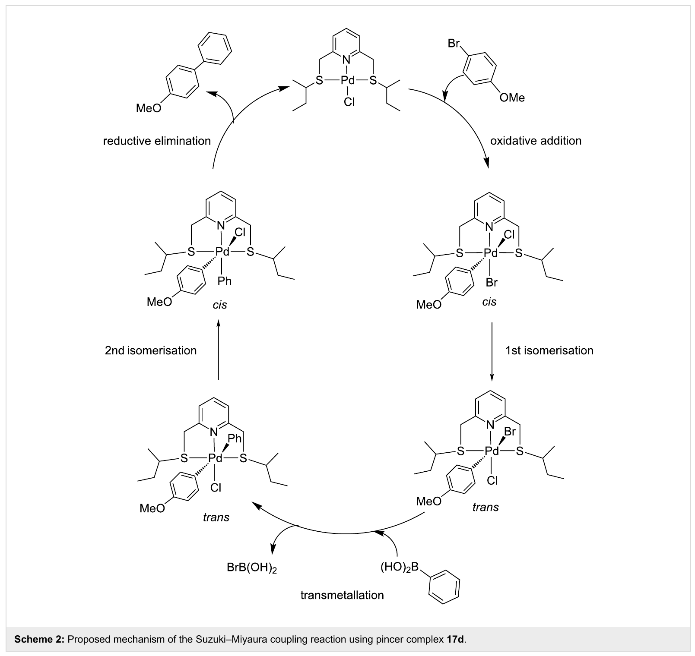
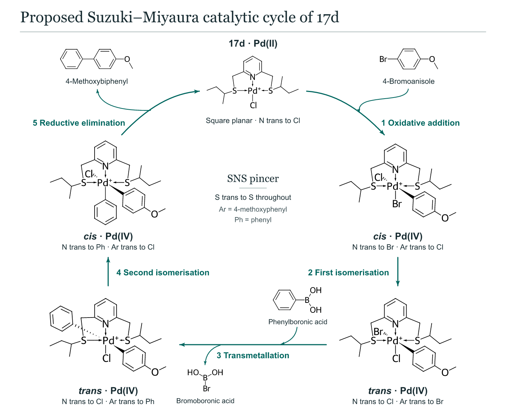
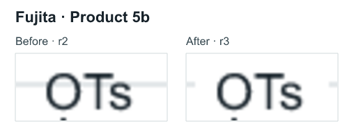
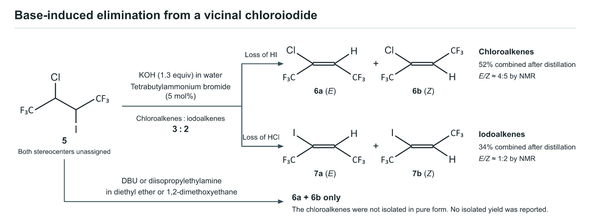
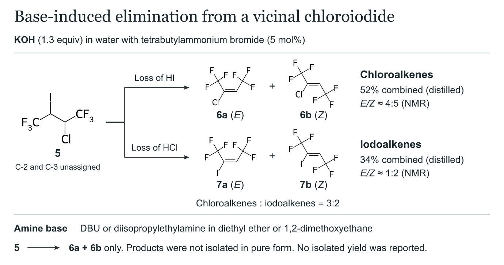

# Chem Canvas

[简体中文](README.md) · **English**

Draw and revise organic chemistry figures with your own agent. The agent writes SVG. You can select a ligand, a reaction condition or a table cell on the canvas and leave a comment on that exact region. Link a structure to its RDKit molecule record when you need to check the chemistry.

[Explore 16 literature cases](https://jiaodu1307.github.io/chem-canvas/index.en.html) · [Copy the install prompt](#install-with-your-agent) · [Get the blind benchmark inputs](benchmarks/README.en.md)

## Supported agents

**Connection or tool discovery tested in the client**

[](docs/agent-hosts.en.md#host-codex)
[](docs/agent-hosts.en.md#host-claude-code)
[](docs/agent-hosts.en.md#host-kimi)
[](docs/agent-hosts.en.md#host-qoder-cli)

Codex and Kimi Code CLI listed the canvas tools. Claude Code and the international Qoder CLI reported a successful connection. Each badge links to its setup instructions.

**Generated configuration tested by starting the server and reading a figure**

[](docs/agent-hosts.en.md#host-trae)
[](docs/agent-hosts.en.md#host-qoder-cn)

This covers TRAE IDE, [TRAE CLI 2.0](docs/agent-hosts.en.md#host-trae-cli), Qoder CN IDE, [Qoder Desktop](docs/agent-hosts.en.md#host-qoder) and the [Chinese Qoder CLI](docs/agent-hosts.en.md#host-qoder-cli). These checks used the MCP SDK.

**Configuration presets checked against the host’s documented format**

[](docs/agent-hosts.en.md#host-cursor)
[](docs/agent-hosts.en.md#host-claude-desktop)
[](docs/agent-hosts.en.md#host-vscode)
[](docs/agent-hosts.en.md#host-copilot-cli)
[](docs/agent-hosts.en.md#host-gemini)
[](docs/agent-hosts.en.md#host-opencode)
[](docs/agent-hosts.en.md#host-zed)

Other agents can connect over local MCP stdio or Streamable HTTP. [Configuration, versions and verification records](docs/agent-hosts.en.md)

## A paper figure and its redraw

| Fiebor et al., Scheme 2 | Agent redraw from reaction data |
| --- | --- |
| [](https://jiaodu1307.github.io/chem-canvas/fiebor-scheme2.en.html#from-data) | [](https://jiaodu1307.github.io/chem-canvas/fiebor-scheme2.en.html#from-data) |

Follow the five arrows around the cycle, then zoom in on the ligands at each palladium centre. The case page records what the drawing agent saw and lets you compare individual runs. [Open the catalytic cycle](https://jiaodu1307.github.io/chem-canvas/fiebor-scheme2.en.html#from-data)

## Ask your agent to edit a selected region

[](https://jiaodu1307.github.io/chem-canvas/fujita-dioxytosylation.en.html#local-edit)

A region note on Fujita’s blind draft asked the agent to clear the OTs label above 5b. The agent opened a gap in the divider. You can now reopen that note and compare the same area across revisions. All 91 changed pixels in the export fell inside the selection, and all 41 editable labels were preserved. [Inspect the edit](https://jiaodu1307.github.io/chem-canvas/fujita-dioxytosylation.en.html#local-edit) · [Run with your own agent](benchmarks/local-selection/fujita-5b/)

When several notes are open, use the copy button on the note you want to send. In a replay with 5b and 5c pending, the earlier request changed 91 pixels in each row. Copying the 5b note changed only that row and left 5c open. [Inspect both requests and export scores](benchmarks/local-selection/fujita-5b/#single-note)

## Two drawings from the same experimental data

Kirij et al.’s Scheme 5 shows two elimination routes and four alkene products. Both agents received the same structures, reactions and experimental data. The paper figure was held back until review.

| Agent draws SVG directly | Agent draws SVG with molecule tools |
| --- | --- |
| [](https://jiaodu1307.github.io/chem-canvas/kirij-scheme5.en.html#from-data) | [](https://jiaodu1307.github.io/chem-canvas/kirij-scheme5.en.html#from-data) |

The direct SVG draft abbreviated all 10 CF₃ groups. The tool-assisted draft retained five molecule records and abbreviated two groups. After a renderer update, the same records produced all 10 abbreviations and passed E/Z checks for all four alkenes. [Inspect the paper, first drafts and updated render](https://jiaodu1307.github.io/chem-canvas/kirij-scheme5.en.html#from-data)

- **Reaction screening.** Compare the reaction header, solvents and bases in a Suzuki–Miyaura screening table. [Contreras et al., Table 2](https://jiaodu1307.github.io/chem-canvas/contreras-table2.en.html)
- **Experimental time series.** Check 40 values at eight time points. At an 85 mm print width, the numeric cells measure 4.10 pt in the blind draft and 8.03 pt in the single-column proof. [Hosoya et al., Table 2](https://jiaodu1307.github.io/chem-canvas/hosoya-batch-oxidation.en.html#print-width)
- **Editable Word tables.** Preserve the bold fifth row and check all 66 exported cells in a reaction screening table. [Aghahosseini et al., Table 1](https://jiaodu1307.github.io/chem-canvas/aghahosseini-table1.en.html#row-emphasis)

## Install with your agent

Paste this into the agent you want to use.

```text
Install Chem Canvas for the agent I am using and verify the connection.
Clone https://github.com/jiaodu1307/chem-canvas to a directory I can keep, or reuse my existing checkout.
Keep track of my current workspace. Follow docs/install-agent.en.md to identify the host and version, install the figure-chemistry profile and preserve my existing MCP servers.
Use canvas_figure in read mode and report the project ID, revision and local canvas URL.
If I need to enable a setting or reopen the session, tell me exactly what to do and how to verify it.
```

[Step-by-step install guide](docs/install-agent.en.md) · [Find your client configuration](docs/agent-hosts.en.md)

## Run locally

From the repository root, with Node.js 24 or later installed, run the following commands.

```sh
npm ci
npm test
npm start
```

Open the SVG workbench, choose a sample, save it and draw a box around the area you want to change. Your agent can read the saved figure, comments and linked molecules in the same project. Projects are stored under `.local/workspace/`. [SVG workbench](http://127.0.0.1:4317/figure.html) · [Local research canvas](http://127.0.0.1:4317/) · [Local literature catalogue](http://127.0.0.1:4317/publication-benchmark.html)

## Connect an agent

Generate an MCP configuration for your host. For example, the drawing-only configuration is available with the following command.

```sh
node scripts/plugin-config.js --profile figure
```

Choose `figure` for figure preview, saving and export, `figure-chemistry` to add molecule parsing and registration, or `full` for shared selections, change proposals and project history. [Host configuration guide](docs/agent-hosts.en.md)

For the native Codex plugin, generate the configuration in this checkout and add the local marketplace. Regenerate the configuration if you move the checkout.

```sh
node integrations/codex/prepare.mjs
codex plugin marketplace add ./integrations/codex
codex plugin add chem-canvas@chem-canvas-local
```

Each case page credits the authors, figure number, paper and figure licence. The code tests use synthetic inputs. [Third-party software and publication credits](THIRD_PARTY.md)
