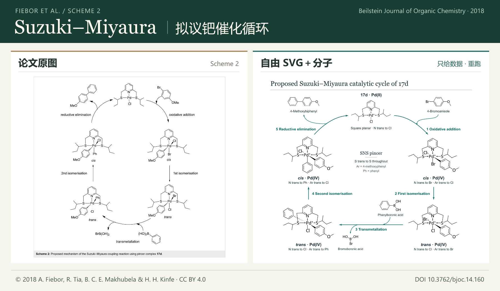
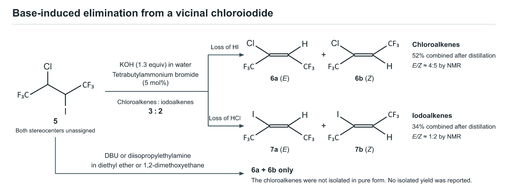
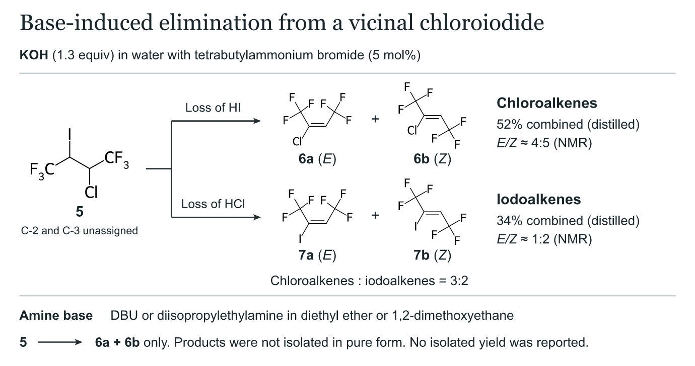

# Chem Canvas

用 Agent 绘制有机化学期刊图表。在本地画布上，你可以框选一处结构或条件文字，让 Agent 修改同一份 SVG。需要核对分子时，图中的结构可以绑定到 RDKit 分子记录。

**[浏览 16 个文献案例](https://jiaodu1307.github.io/chem-canvas/)**　·　[复制安装提示词](#把这段话发给你的-agent)　·　[查看支持的客户端](docs/agent-hosts.zh-CN.md)

[](https://jiaodu1307.github.io/chem-canvas/fiebor-scheme2.html#from-data)

在这张催化循环里，可以沿五个箭头核对反应顺序，也可以逐个检查钯中心的配体位置。打开案例可放大图稿，查看每次重绘的结果。[钯催化偶联循环 · Fiebor 等，Scheme 2](https://jiaodu1307.github.io/chem-canvas/fiebor-scheme2.html#from-data)

## 同一份实验数据，两种成图

Kirij 等人的 Scheme 5 有两条消除途径和四个烯烃产物。下面两次独立绘图只向 Agent 提供反应、结构和实验数据，论文原图留到出图后核对。

| Agent 直接绘制 SVG | Agent 绘制 SVG，插件嵌入分子 |
| --- | --- |
| [](https://jiaodu1307.github.io/chem-canvas/kirij-scheme5.html) | [](https://jiaodu1307.github.io/chem-canvas/kirij-scheme5.html) |

纯 SVG 稿画出了全部 10 处 CF₃ 缩写。插件初稿保留了 5 份分子结构记录，但只缩写了 2 处。更新渲染器后，同一份图稿可显示全部 10 处缩写，原有 4 个双键的 E/Z 也通过核对。[对照论文、查看逐项评分与新版 SVG](https://jiaodu1307.github.io/chem-canvas/kirij-scheme5.html)

复跑盲测可直接取用原始任务，完成绘图后再查看逐项结果。[取用评测输入](benchmarks/README.md)

- **条件筛选表**　比较 Suzuki–Miyaura 偶联的溶剂和碱筛选，检查表头反应式与数据列的排版。[Contreras 等 · Table 2](https://jiaodu1307.github.io/chem-canvas/contreras-table2.html)
- **实验时间序列**　逐行核对两组批式氧化实验的八个时间点，并查看 85 mm 单栏校对稿。[Hosoya 等 · Table 2](https://jiaodu1307.github.io/chem-canvas/hosoya-batch-oxidation.html)

## 把这段话发给你的 Agent

```text
请帮我把 Chem Canvas 安装到当前使用的 Agent，并实际验证。仓库是 https://github.com/jiaodu1307/chem-canvas。
请将官方仓库克隆到一个长期保留的目录。已有这份源码时可以复用。
先记住我当前打开的工作区，按仓库 docs/install-agent.zh-CN.md 识别宿主和版本，安装 figure-chemistry 配置，保留已有 MCP 服务。
完成后请调用 canvas_figure 只读打开图稿，告诉我项目 ID、修订号和画布链接。
如果必须由我启用开关或重开会话，请告诉我具体操作和验证口令。
```

TRAE、Qoder、Kimi Code、Codex 等客户端通过 MCP 连接本地画布。各客户端的配置位置和实测范围见指南。[安装步骤与验证口令](docs/install-agent.zh-CN.md) · [客户端兼容情况](docs/agent-hosts.zh-CN.md)

## 本地运行

使用 Node.js 24 或更高版本，在仓库根目录执行以下命令。工作区默认保存在 `.local/workspace/`。

```sh
npm ci
npm test
npm start
```

启动后打开 SVG 工作台，选一份示例图稿，点击「保存图稿」，再框选需要修改的区域写下批注。Agent 可在同一项目中读取图稿、批注和关联分子。[SVG 工作台](http://127.0.0.1:4317/figure.html) · [本地研究画布](http://127.0.0.1:4317/) · [本地文献目录](http://127.0.0.1:4317/publication-benchmark.html)

## 接入 Agent

宿主可通过 stdio 启动画布，或连接本机的 Streamable HTTP 服务。要生成只含绘图工具的 MCP 配置，运行以下命令。

```sh
node scripts/plugin-config.js --profile figure
```

`figure` 提供图稿预览、保存和导出。`figure-chemistry` 增加分子解析与录入。`full` 还提供共享选区、修改提案和项目历史。[配置示例](docs/agent-hosts.zh-CN.md)

使用 Codex 原生插件时，先在当前仓库生成 MCP 配置，再添加本地市场。移动源码后需要重新生成配置。

```sh
node integrations/codex/prepare.mjs
codex plugin marketplace add ./integrations/codex
codex plugin add chem-canvas@chem-canvas-local
```

文献案例页列有作者、图表编号、论文链接和图像许可；源码测试使用合成输入。[第三方软件与论文图像说明](THIRD_PARTY.md)
