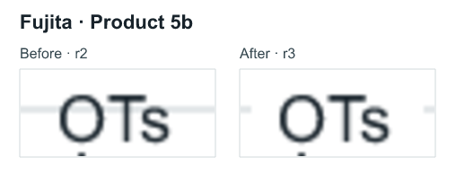

# Fujita 5b · 局部改图 / Region edit

## 中文

Fujita 等人在 Table 1 报告了三组苯乙烯实验。既有评阅发现，直接绘制的 SVG 中，产物 5b 和 5c 上方的 OTs 与行分隔线相交。本题模拟研究者只圈出 5b 要求修改。5c 是容易误改的对照。[文献](https://doi.org/10.3762/bjoc.14.53) · [原评阅](../../publication/data-only/cases/fujita-dioxytosylation/review.json) · [原始盲稿 SVG](https://jiaodu1307.github.io/chem-canvas/fujita-dioxytosylation-svg.svg)

1. 在独立的空项目中打开并保存原始盲稿。公开 checkout 内的文件是 `docs/fujita-dioxytosylation-svg.svg`。使用原始的 960 × 645 图稿坐标，框选从 (850, 272) 到 (902, 295) 的区域。框中应该能看到第二行产物 5b 的上方 OTs 和穿过它的浅灰横线。
2. 将下面这句话作为框选批注提交，让 Agent 读取图稿和批注、修改 SVG 并保存一版。测试 Agent 时只给原稿与批注，评分器留给评阅者。

   > 只改框中 5b 上方的灰色分隔线。在 y=282 处从 x=852 到 x=900 留出缺口，让 OTs 标签完整可见。其余线段、结构、文字、实验数据和 5c 保持原样。

3. 重新读取保存的图稿与版本，导出这一版 SVG。在下面的命令中用导出文件的路径替换 `exported.svg`。记录项目、批注、保存与导出的版本、Agent 及计分 JSON。
4. 从原批注同时查看旧版和新版的同一选区。记录目检时是否能辨认 5b 的 OTs 和缺口，再从全图确认 5c 仍与其原横线相交。程序按同一次运行的字体渲染原稿、目标和导出，逐像素检查框内及框外，并核对所有可编辑文字。

## English

Fujita et al. reported three styrene series in Table 1. In the earlier visual review, row dividers crossed the upper OTs labels on products 5b and 5c in the SVG blind draft. The researcher selects only 5b. Product 5c tests whether the agent also edits a similar feature elsewhere. [Paper](https://doi.org/10.3762/bjoc.14.53) · [Original review](../../publication/data-only/cases/fujita-dioxytosylation/review.json) · [Blind draft SVG](https://jiaodu1307.github.io/chem-canvas/fujita-dioxytosylation-svg.svg)

1. Open and save the blind draft in a new project. The published checkout includes it at `docs/fujita-dioxytosylation-svg.svg`. In the original 960 × 645 coordinate system, drag from (850, 272) to (902, 295). The box should enclose the upper OTs label in row 5b and the crossing divider.
2. Submit this region note. Give the agent the original artwork and the note. Keep the scoring script with the reviewer.

   > Edit the gray divider above 5b in the selected region. Leave a gap at y=282 from x=852 to x=900 so the OTs label is fully visible. Preserve the rest of the divider, all structures, labels and data, and row 5c.

3. Ask the agent to read the figure and note, edit the SVG and save a revision. Read back the saved revision and export its SVG. Score the export with the command below. Record project and note identifiers, saved and exported revisions, agent and score JSON.
4. Use the original note to view its region on both revisions. Visually inspect the upper OTs on 5b and the new gap. Check the full figure for the original crossing on 5c. Record these observations alongside the score. The scorer uses one local renderer and font set to compare the selected pixels to the requested gap and every outside pixel to the original. It checks the content and count of every editable SVG label.

## 实测记录 / Recorded run



实际批注要求在分隔线与 5b 标签交叠处留白。保存新版后，旧流程只能提示该批注属于旧稿。本次复测用同一条批注取回了 r2 和 r3 的两张选区图，以上按四倍放大展示。图上可见灰线从字中穿过，修改后两端停在字外。对 r3 导出文件的程序核查记录了 91 个框内像素变化、零个框外变化，全部 41 个标签均保留。

The recorded note asked for a gap where the divider crossed 5b. Previously, reopening the note after saving returned a stale-position error. The retest retrieved crops from r2 and r3 through the same note. Shown at 4×, the gray rule crosses OTs on the left and stops on either side on the right. The export check counted 91 changed pixels inside the box, zero outside, and all 41 original labels. [Recorded r3 export](example-export.svg)

<a id="single-note"></a>

## 只把 5b 交给 Agent / Hand off 5b alone

[查看工作台实图，定位单条和全部复制按钮 / See the workbench with both selections and copy buttons](editor-handoff.png)

1. 另开空项目，按上文添加 5b 框选批注。在 (850, 420) 到 (902, 443) 另框出 5c，留下第二条要求为 5c 横线开缺口的批注。两条均保持待核对。
2. 在 5b 批注上点「复制这条给 Agent」，将剪贴板原文交给 Agent。保存修改前后各读取一次图稿，导出已保存的版本。保留剪贴板原文，以及每次读取返回的项目标识、图稿标识、修订号、源摘要和批注。
3. 用下方 `--handoff` 命令核对请求指向哪条批注、5c 是否仍待核对，以及实际导出的 5c 和框外图稿有没有变化。这几项测量可以区分复制时混入其他批注，以及 Agent 在接收单条批注后误改邻行这两种情况。

1. Start a new project and add the 5b region note from above. Add another note around 5c, from (850, 420) to (902, 443), asking for a gap in its divider. Leave both notes open.
2. Use the copy button on the 5b note and give the agent the clipboard text verbatim. Read the figure before and after saving the edit, then export the saved revision. Keep the copied text and both reads, including project and figure identifiers, revisions, source hashes and notes.
3. Run the `--handoff` check below. It identifies the note addressed in the request, checks that 5c remains open, then scores the actual export. These measurements distinguish a request that includes both notes from an edit that changes both rows after the agent received only 5b.

两次实测都通过浏览器添加批注、复制请求，由确定性程序按剪贴板里的 MCP 调用读图并保存 SVG。程序按读到的每一条批注为对应的 OTs 留白，模型调用次数为零。基线固定在提交 `93ebddb`。Both runs used the browser clipboard and a deterministic MCP client. It opened a gap for each note addressed by the copied request. There were zero model calls.

| 实测 / Run | 剪贴板指定的批注 / Addressed | 5b 改变像素 / Changed | 5c 改变像素 / Changed | r4 保存后 / After save |
| --- | --- | ---: | ---: | --- |
| [93ebddb 基线 / Baseline](handoff-baseline.json) | 5b, 5c | 91 | 91 | 两条均待核对 / Both open |
| [仅复制 5b / Copy 5b alone](handoff-single.json) | 5b | 91 | 0 | 两条均待核对 / Both open |

两个选框以外的像素差异均为零。单条复测在 r5 从界面仅标记 5b 已核对，5c 仍待处理。Outside both boxes, each export had zero changed pixels. After the reviewer marked 5b complete in the single-note run, 5c remained open at r5.

新的测试回执可参照以上 JSON。填写隔离项目 ID、两条批注 ID、剪贴板原文和实际导出文件的 SHA-256。保存前后的 `before` 和 `after` 从各次 `canvas_figure` 读取结果取值，保留 `documentId`、`revision`、`figure.id`、`figure.sourceSha256` 以及 `figure.reviewNotes` 中的 ID、文字、位置和版本字段。For a new run, follow the recorded JSON shape. Use the captured clipboard text and the identifiers, notes and hashes from the two figure reads and the export.

## 运行 / Run

在安装依赖后的仓库根目录执行。Run from the repository root after `npm ci`.

```sh
node benchmarks/local-selection/fujita-5b/check.mjs --self-test
node benchmarks/local-selection/fujita-5b/check.mjs benchmarks/local-selection/fujita-5b/example-export.svg
node benchmarks/local-selection/fujita-5b/check.mjs exported.svg
```

在用例目录运行以下两条命令。基线预期退出 1，单条复测预期退出 0。Run these commands from the case directory. The baseline should exit 1 and the single-note run should exit 0.

```sh
node check.mjs --handoff handoff-baseline.json handoff-baseline.svg
node check.mjs --handoff handoff-single.json example-export.svg
```

计分成功时退出码为 0。通过需要 `selectedMismatchPixels` 和 `outsideSelectionChangedPixels` 均为 0，且 `editableLabelsPreserved` 为 true。`control5cChangedPixels` 单列 5c 对应框中的像素差异。`targetChangedPixels` 是本机渲染时参考缺口实际改变的像素数。

A passing export exits with status 0. Both `selectedMismatchPixels` and `outsideSelectionChangedPixels` must be zero, and `editableLabelsPreserved` must be true. `control5cChangedPixels` reports outside changes in the corresponding 5c box. `targetChangedPixels` measures the visible change expected from the reference gap using the local renderer.
